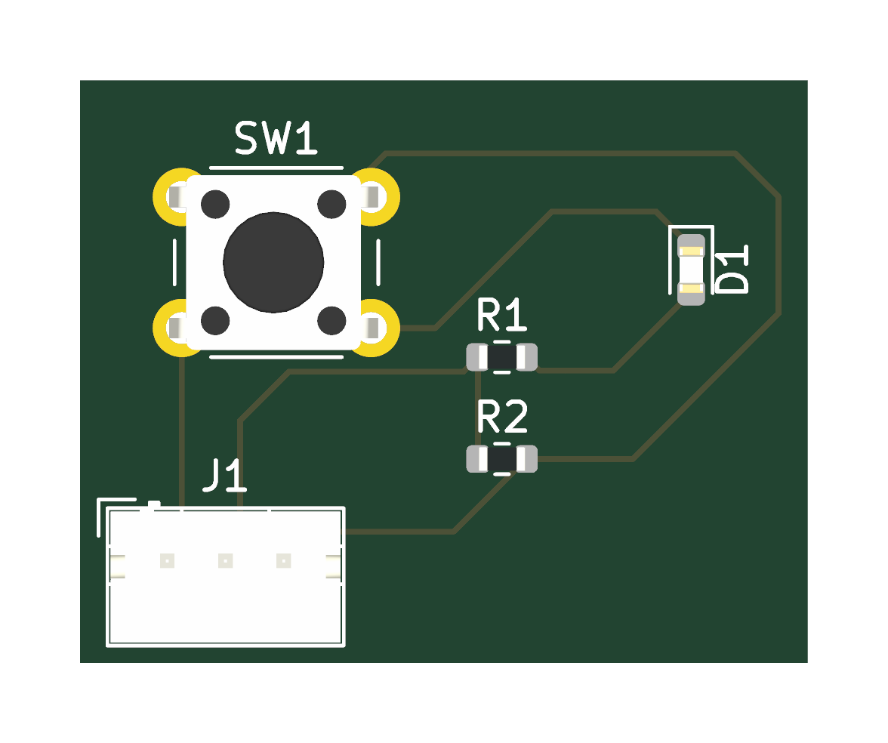
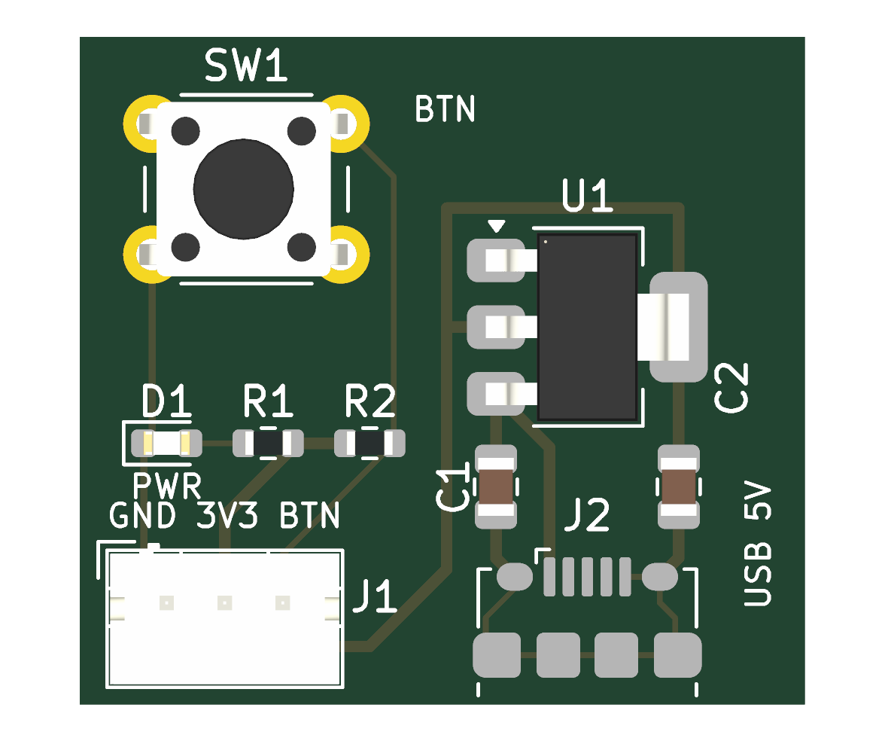

# Hardware learning log: PCB design with KiCad

Small boards I design while teaching myself electronics and PCB design in **KiCad 10**, with robotics in mind. Each project uses only what I had learned at that point, and the next one builds on it, so the repo shows the progress from my first schematic to complete microcontroller boards.

Every project folder has the KiCad files, a PDF of the schematic, 3D renders, a BOM, the automatic check results and a README that explains **what I decided and why**.

## Projects

| # | Project | What's new in it | Status | |
|---|---|---|---|---|
| P00 | [Mini-Dashboard V1](projects/P00-mini-dashboard-v1/) | first schematic and PCB: LED with series resistor, button with pull-up, JST connector, GND zone | designed, ERC/DRC clean |  |
| P01 | [Mini-Dashboard V2](projects/P01-mini-dashboard-v2/) | its own power supply: micro-USB 5 V → NCP1117 linear regulator → 3.3 V, heat calculation, decoupling placement | designed, ERC/DRC clean |  |
| P02 | Mini-Dashboard V3 (planned) | its own RP2040 microcontroller: flash, crystal, USB data | planned | |

"Designed" means schematic and PCB are finished and pass KiCad's checks. Boards that were manufactured and tested will say so, with measurements.

## How I work

1. Learn one topic from a complete, documented design (currently Raspberry Pi's *Hardware design with RP2040*).
2. Design a small board that uses it, following a fixed order of work with checks between the steps: schematic → ERC and reading the netlist → footprints → board outline and connectors → placement → net classes → routing → DRC with schematic parity → labels.
3. Review it against a checklist and write down what I would do differently. Those lessons are in each project's README and CHANGELOG.

## Repository layout

```
projects/<Pnn-name>/
  kicad/      KiCad 10 project (.kicad_pro, .kicad_sch, .kicad_pcb)
  docs/       schematic.pdf, pcb_top.png, pcb_bottom.png, bom.csv, checks.md (generated)
  README.md   what, why, design decisions, status, known issues, test plan
  CHANGELOG.md
templates/    README and CHANGELOG templates for new projects
tools/        update_docs.py: copies the latest KiCad files in and regenerates docs/
```

Regenerate the docs after a change (needs KiCad 10 installed):

```
python tools/update_docs.py
```

## Licence

Copyright 2026 Mohammed Elganayni.

The hardware designs in this repository are licensed under the **CERN Open Hardware Licence Version 2 – Permissive** (SPDX: `CERN-OHL-P-2.0`), see [LICENSE](LICENSE). You may use, modify, manufacture and distribute them; please keep the copyright and licence notice.

KiCad's standard symbol and footprint libraries and the manufacturers' datasheets referenced here have their own terms.
