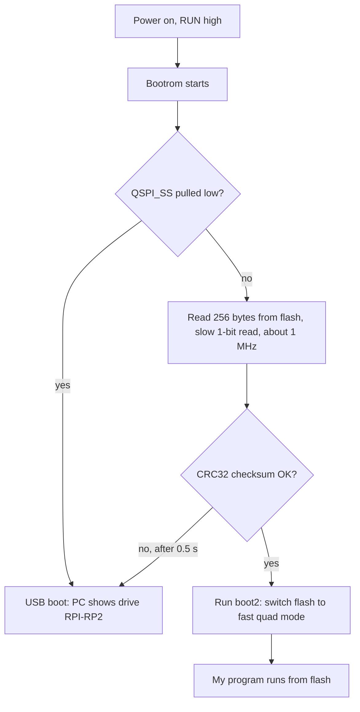

# R2 · RP2040: flash memory and boot

**Date:** 2026-11-23 · **Source:** Raspberry Pi, *Hardware design with RP2040* (minimal design, flash section), the RP2040 datasheet and the Winbond W25Q128JV datasheet · **Own project:** none yet (see [Why no project](#why-no-project-after-r2))

After unit R1 the RP2040 had clean power. R2 answers three questions:

1. **Where does the program live?**
2. **How does the chip find and start it?**
3. **How do I put a new program on it, or restart it?**

## What R2 covers on the minimal board

The whole unit is four parts plus one header pin:

| Part | Value | Job |
|---|---|---|
| U2 | W25Q128JVSIQ, SOIC-8 | 16 MB flash, holds the program |
| C5 | 100 nF | decoupling capacitor for the flash (one per chip, the rule from R1) |
| R1 | 1 kΩ | lets the boot jumper pull QSPI_SS low without a short |
| R2 | 10 kΩ, **not fitted (DNP)** | optional pull-up on QSPI_SS, footprint kept "just in case" |
| J2 | 2-pin header | the USB_BOOT jumper |
| RUN | header pin | the reset pin, brought out with no parts on it |

## 1. Where the program lives: external flash

The RP2040 has a 16 kB **ROM** (fixed at the factory) and 264 kB of **SRAM** (lost at power-off), but **no flash inside**. A program that must survive being unplugged therefore goes into a separate flash chip.

- 128 **Mbit** ÷ 8 = **16 MB**. Flash chips are sold in megabits, so always divide by 8.
- 16 MB is the most the RP2040 can use: the boot read uses 24-bit addresses, and 2²⁴ bytes = 16 MB.
- The RP2040 runs the program **directly from the flash** (XIP, "execute in place"), with a small cache in between.

## 2. QSPI: how the chip and the flash are connected

SPI is a simple chip-to-chip bus: a chip select, a clock and data lines. **Quad SPI** uses **4 data lines** instead of 1, so it moves 4 bits per clock tick instead of 1.

| Signal | What it does |
|---|---|
| QSPI_SS | chip select, **active low** (0 V = "I'm talking to you") |
| QSPI_SCLK | clock, one tick per transfer |
| QSPI_SD0–SD3 | the four data lines |

That makes **6 wires** between the RP2040 and the flash.

- One byte takes 8 clocks in plain SPI and **2 clocks** in QSPI.
- On the flash, IO2 and IO3 double as /WP (write protect) and /HOLD. The **Q** at the end of `W25Q128JVSIQ` means quad mode is fixed on from the factory, so these are always data pins and need no pull-ups. **Read the full part number**: the M variant behaves differently.
- The RP2040's QSPI pins are **not in order** (SD3 = pin 51, SD0 = 53, SD1 = 55). I copy the pin table, I don't guess.
- Layout rule: short, direct traces. On the minimal board all six are on the top layer, no vias, 8–23 mm long.

## 3. How the chip finds and starts the program: the boot sequence

- The **bootrom** is 16 kB of code inside the chip that runs first, every time, and a bad program can't break it.
- It reads the first 256 bytes with the one command almost every flash understands (`03h`), checks a **CRC32 checksum**, and runs that small "second stage" (boot2). boot2 sets up the fast mode for *this* flash chip.
- Design idea I want to remember: **use the safe, universal way first, then let specific code switch to the fast way.**
- Reading the 256 bytes takes about 2080 clock ticks ≈ **2 ms** at 1 MHz.
- **A new board with an empty flash goes into USB boot by itself**, because there is no valid checksum. "It does nothing" is normal there.

## 4. Putting a new program on it: USB boot

The bootrom checks **QSPI_SS** once at start-up. If it reads 0, the chip skips the flash and shows up on the PC as a USB drive called **RPI-RP2**. I drag a `.uf2` file onto it and it gets written to the flash.

**Why the jumper goes through 1 kΩ (R1) and not straight to GND:** QSPI_SS is also the flash's chip select, so the chip must still be able to drive it high to write the new program.

| Case | Calculation | Result |
|---|---|---|
| Jumper on, chip only listening | 3.3 V · 1 kΩ / (1 kΩ + 50 kΩ internal pull-up) | 0.065 V → reads **0** → USB boot |
| Jumper on, chip drives SS high | 3.3 V / 1 kΩ | 3.3 mA, less than the pin's 4 mA, so the line still reads **1** for the flash |
| Jumper straight to GND, no R1 | — | pin shorted, flash can never be deselected, programming fails |

Rule: **to force a pin that is also an output, pull it through a resistor, never directly.**

**R2, the pull-up that isn't fitted:** the flash wants its chip select to follow its supply at power-up. With this flash Raspberry Pi found it unnecessary, so R2 has a footprint but is marked **DNP**. Lesson: if I'm not sure a part is needed, I give it a footprint and leave it empty, because I can solder a resistor later but I can't add a pad to a finished PCB. (With R2 fitted the jumper still works: 10 kΩ ∥ 50 kΩ = 8.3 kΩ → 0.35 V, still a 0.)

## 5. Restarting it: the RUN pin

RUN low = chip held in reset, RUN high = chip runs. RUN has an **internal pull-up**, so with nothing connected it runs. On the minimal board RUN only goes to a header pin, right next to a GND pin, so shorting the two for a moment resets the chip.

A reset button goes from RUN **to GND**. Wired to 3.3 V it would do nothing.

**Loading a new program on this board:**
1. Jumper on J2.
2. Reset (short RUN to GND, or replug USB).
3. Copy the `.uf2` onto the RPI-RP2 drive.
4. **Take the jumper off**, or the board goes into USB boot again at every reset.
5. Reset again, and my program runs.

> **Not sure:**
> - The final flash clock after boot2 is set by software (the Pico SDK). I didn't check its default, so I give no number for it.
> - I assumed RUN's internal pull-up is in the same 50–80 kΩ range as the other pins. The datasheet table I used is for the digital I/Os in general.

## German words I learned

| Deutsch | English |
|---|---|
| der Flash-Speicher | flash memory |
| flüchtig / nichtflüchtig | volatile / non-volatile |
| die Chipauswahl | chip select |
| der Takt | clock |
| die Prüfsumme | checksum |
| die Steckbrücke | jumper |
| der Spannungsteiler | voltage divider |
| nicht bestücken (DNP) | do not populate |
| zurücksetzen | to reset |

## Why no project after R2

Flash and boot only make sense on a board with an RP2040, and an RP2040 board also needs the crystal (R3) and USB (R4) before it can be programmed. So this circuit goes into **P02 Mini-Dashboard V3** after R4: flash + decoupling, 1 kΩ to a BOOTSEL button, and a reset button on RUN.
