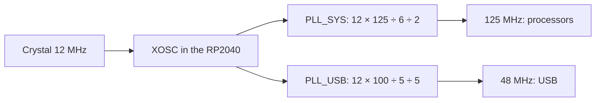

# R3 · RP2040: the crystal (clock)

**Date:** 2026-11-23 · **Source:** Raspberry Pi, *Hardware design with RP2040* (minimal design, crystal section) and the RP2040 datasheet (XOSC, ROSC, PLLs) · **Own project:** none yet (see [Why no project](#why-no-project-after-r3))

After R2 the RP2040 had power and a program, but it was still running on a rough internal clock. USB needs an exact one. R3 answers four questions:

1. **Why does the chip need a crystal at all?**
2. **How does a crystal make a frequency?**
3. **Which capacitors and resistor does it need, and why these values?**
4. **Who turns the crystal on?**

## What R3 covers on the minimal board

The smallest block on the board, four parts:

| Part | Value | Job |
|---|---|---|
| X1 | ABM8-272-T3, 12 MHz, 3.2 × 2.5 mm, 4 pads | the crystal: the board's "tuning fork" |
| C2 | 15 pF, C0G, 0402 | load capacitor on the XIN side |
| C3 | 15 pF, C0G, 0402 | load capacitor on the XOUT side |
| R5 | 1 kΩ, 0402 | limits how hard the chip drives the crystal |
| U3 pins 20, 21 | XIN, XOUT | where the crystal meets the RP2040 |

The crystal does not run the chip directly. Two **PLLs** (frequency multipliers inside the chip) turn it into the clocks the chip uses:

So if the 12 MHz is exact, everything else is exact too.

## 1. Why a crystal, when the chip has its own oscillator

The RP2040 has a **ring oscillator (ROSC)** inside that needs no parts. At boot it runs at about 6.5 MHz, but the datasheet only guarantees **1.8 to 12 MHz**, and it changes from chip to chip, with voltage and with temperature. That's fine for the bootrom, but not for USB, UART or exact timers.

A **crystal** is a small slice of quartz that vibrates at one very exact frequency. Accuracy is given in **ppm** (parts per million):

- 1 ppm = 10⁻⁶, and 1 % = 10 000 ppm. So 30 ppm is 0.003 %, not 0.3 %.
- This crystal: ±30 ppm at 25 °C, plus ±30 ppm over temperature, so about **±60 ppm** worst case.
- At 12 MHz: 12 000 000 Hz · 30 · 10⁻⁶ = **±360 Hz**.
- As a wall clock, 30 ppm would be about **2.6 s per day**.
- The ROSC can be from 72 % too slow to 85 % too fast, about **10 000× worse**.
- The RP2040 itself tolerates up to 1000 ppm on the crystal, so this crystal is well inside.

Rule: **if anything on the board needs exact time (USB!), you need a crystal.** Without it the chip still boots, but USB, and with it USB boot from R2, won't work.

## 2. How a crystal makes a frequency: the oscillator loop

A crystal has no power pin. Quartz is **piezoelectric**: a voltage bends it, and bending it makes a voltage. Put it in a loop with an **amplifier**: the amplifier pushes, the crystal rings and sends the signal back, the amplifier pushes again. Only the crystal's own frequency survives the loop. This is a **Pierce oscillator**, and almost every microcontroller uses it.

- The **amplifier is inside the RP2040**, between XIN (input) and XOUT (output). The datasheet calls it the **XOSC**.
- The board only adds what the chip can't contain: the crystal, the two capacitors and R5.
- Design idea I want to remember: **the chip has the active half; the board supplies the frequency-setting half.**
- X1 has 4 pads: pins 1 and 3 are the quartz, pins 2 and 4 are the **metal lid**, connected to GND.
- One clock period: 1 / 12 MHz = **83.3 ns**.
- Starting up takes time: the vibration grows from noise. The datasheet example waits 47 · 256 = 12 032 cycles ≈ **1 ms** before the clock is trusted.

## 3. The load capacitors C2 and C3

A crystal's exact frequency depends a little on the capacitance around it. The maker tells you which capacitance gives exactly 12.000 MHz: the **load capacitance** C_L. For the ABM8-272-T3, **C_L = 10 pF**.

Seen from the crystal, C2 and C3 are **in series** (pin 1 → C2 → GND → C3 → pin 3). The **stray capacitance** of traces and pins adds on top; the guide assumes about **3 pF**.

Working backwards:

| Step | Calculation |
|---|---|
| The two caps in series must give | 10 pF − 3 pF = 7 pF |
| Two equal caps in series give half their value, so each is | 2 · 7 pF = 14 pF |
| Nearest standard (E12) value | **15 pF** |
| Check | 15 · 15 / (15 + 15) = 7.5 pF, + 3 pF = **10.5 pF** (target 10 pF, close enough) |

Rule for equal caps: **C2 = C3 = 2 · (C_L − C_stray)**.

- **Don't use C_L directly as the cap value.** 10 pF caps would give 5 + 3 = 8 pF.
- **Use C0G (NP0) capacitors.** X7R or Y5V change their value with temperature and voltage by 10–80 %, and these caps set a frequency. (The 100 nF decoupling caps from R1 can be X7R.)
- **New crystal → new caps.** Read C_L for every crystal you pick.
- **Keep the traces short**, because every millimetre adds stray capacitance.

## 4. R5: don't shake the crystal too hard

A crystal really moves. Driven too hard, it can age faster, shift frequency or crack. The limit is the **drive level**: max **200 µW** for the ABM8-272, and its internal resistance (**ESR**) is max **50 Ω**.

P = I² · ESR ≤ 200 µW → I ≤ √(200 µW / 50 Ω) = **2 mA (rms)** through the crystal.

The RP2040's XOUT at 3.3 V can push more than that, so **R5 = 1 kΩ** sits in series with XOUT. It's a balance:

| R5 | Result |
|---|---|
| too small or 0 Ω | the crystal may be over-driven |
| too large | the loop gets too weak, the crystal starts slowly or not at all |
| 1 kΩ | tested by Raspberry Pi for this crystal at 3.3 V |

- R5 must sit on the **XOUT** side (the amplifier's output). The crystal itself has no direction.
- A different crystal (other ESR or drive level) or a lower pin voltage than 3.3 V means R5 has to be tested again.

Design rule I want to remember: **when a circuit was tuned by testing, copy it exactly, or test it again yourself.**

## 5. On the PCB and in the software

**Layout** (measured in the minimal board's PCB file):

| What | Value |
|---|---|
| X1 | 12.3 mm straight below the RP2040's centre |
| C2, C3 | right next to X1 |
| R5 | between the RP2040 and X1, right at the XOUT pin |
| XIN trace | 11.2 mm, top layer |
| XOUT trace (chip → R5) | 2.8 mm, top layer |
| Vias on the crystal nets | none |

**Don't take the clock from XIN or XOUT** for another chip, and be careful with a scope probe there: the extra capacitance loads the oscillator and can shift or stop it. The RP2040 can output a clock on a GPIO instead.

**Software:** the circuit alone does nothing. The XOSC is **off at power-on**, and the chip boots on the ROSC. The Pico SDK then:

1. turns on the XOSC and waits until it reports "stable" (~1 ms),
2. starts the PLLs: 12 × 125 ÷ 6 ÷ 2 = **125 MHz** and 12 × 100 ÷ 5 ÷ 5 = **48 MHz**,
3. switches the clocks over to the PLLs.

The SDK's defaults assume a **12 MHz** crystal, another reason to stay with 12 MHz. "The board runs but USB is dead" can also be a software clock setting, not only soldering.

The full chain from power-on: RUN high → bootrom on the ROSC → flash (R2) → my program → XOSC on → PLLs → 125 MHz and 48 MHz.

> **Not sure:**
> - The USB full-speed tolerance (±0.25 %) is from memory, not checked in the USB specification. The conclusion doesn't change: the crystal is far inside it, the ROSC far outside.
> - I didn't have Abracon's own crystal datasheet, so I can't say how many ppm the 0.5 pF load-capacitance mismatch costs. It should be small next to the crystal's own ±30 ppm.
> - I don't know how the SDK behaves if the crystal never starts (wait forever or time out).

## German words I learned

| Deutsch | English |
|---|---|
| der Quarz | crystal |
| der Quarzoszillator | crystal oscillator |
| der Takt / die Taktfrequenz | clock / clock frequency |
| der Ringoszillator | ring oscillator |
| die Genauigkeit | accuracy |
| piezoelektrisch | piezoelectric |
| der Verstärker | amplifier |
| anschwingen / die Einschwingzeit | to start oscillating / start-up time |
| die Lastkapazität | load capacitance |
| die Streukapazität | stray capacitance |
| in Reihe geschaltet | connected in series |
| das Dielektrikum | dielectric |
| der Serienwiderstand | series resistor |
| übersteuern | to over-drive |
| die PLL (Phasenregelschleife) | phase-locked loop |
| der Teiler | divider |

## Why no project after R3

A crystal alone doesn't make a board do anything new: you only see it work once USB is there. So this block goes into **P02 Mini-Dashboard V3** after R4, exactly as Raspberry Pi drew it: ABM8-272-T3, 2 × 15 pF C0G, 1 kΩ on XOUT, all close to the chip.
