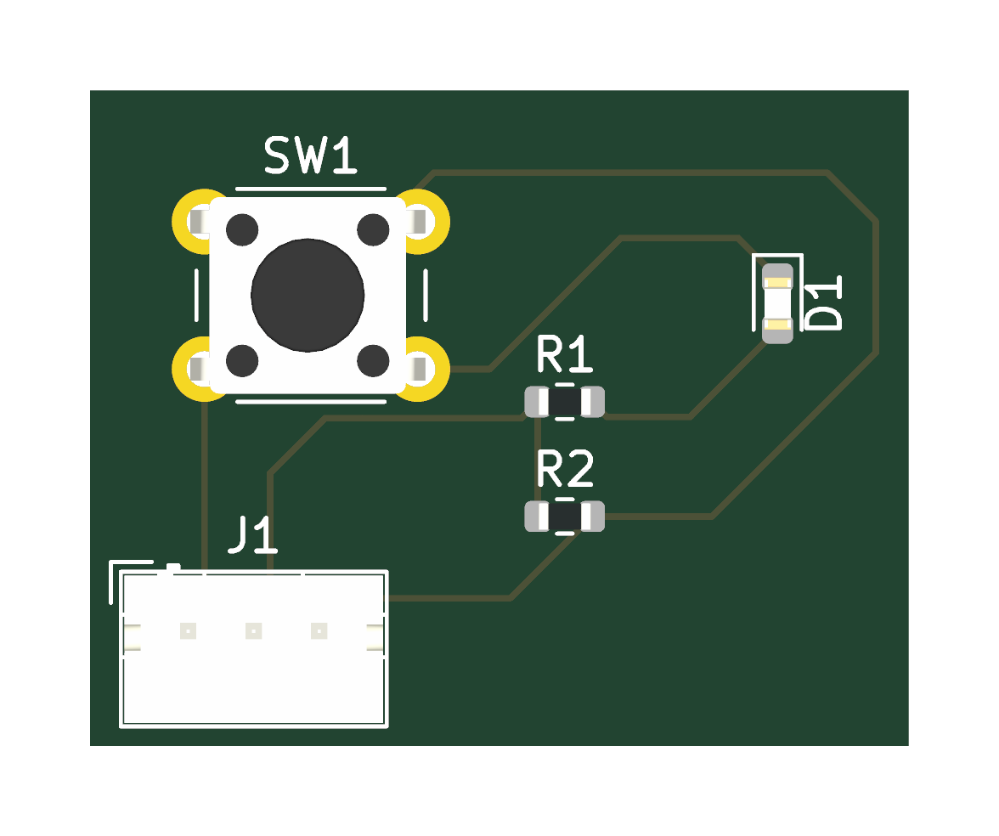
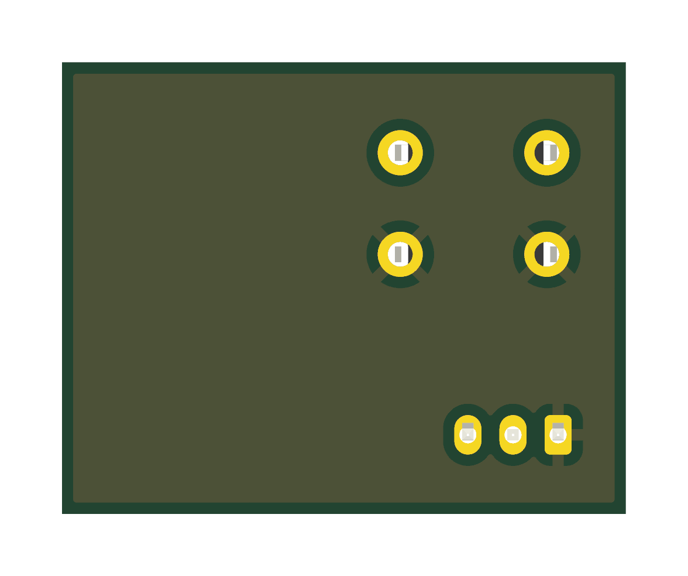

# P00 · Mini-Dashboard V1

My first schematic and PCB: a tiny board with a **power LED** and a **push button**, connected to a microcontroller board by a 3-pin JST PH cable. The microcontroller board supplies the 3.3 V.

| Top | Bottom |
|---|---|
|  |  |

| | |
|---|---|
| Board | 25 × 20 mm, 2 copper layers, parts on top |
| Parts | 5 (LED, 2 resistors, button, connector) |
| Checks | see [docs/checks.md](docs/checks.md): ERC 0 / 0, DRC 0 / 0 with schematic parity |
| Files | [schematic PDF](docs/schematic.pdf) · [BOM](docs/bom.csv) · [KiCad project](kicad/) |
| Status | designed, **not manufactured, not tested** |

## Interface

| J1 pin (JST PH, 2.0 mm) | Signal | Direction |
|---|---|---|
| 1 | GND | — |
| 2 | +3.3 V | in, from the MCU board |
| 3 | BTN | out: 3.3 V = released, 0 V = pressed |

## Design decisions

| Decision | Why |
|---|---|
| **R1 = 270 Ω** in series with a red LED | the LED takes about 2.0 V, the resistor the remaining 1.3 V: I = 1.3 V / 270 Ω ≈ **4.8 mA**, enough for an indicator. Resistor power 6.3 mW |
| **Button to GND with a 10 kΩ pull-up (R2) on the board** | released → R2 pulls BTN to 3.3 V, pressed → 0 V. On the board so it works with any MCU, even if the firmware forgets its internal pull-up. Current while pressed: 0.33 mA |
| **No 100 nF capacitor** | there is no chip on the board, so nothing draws fast current bursts |
| **0603 SMD parts, 6 mm through-hole button** | 0603 is still comfortable to hand-solder; the through-hole button survives being pressed |
| **PWR_FLAG on +3.3 V and GND** | power enters through the connector's passive pins, so ERC needs to be told the nets are powered from outside |
| **GND zone on the bottom layer** | through-hole GND pads connect to it directly; less routing |
| **Trace between the button's two pads "1"** | the button connects them internally, but KiCad's DRC treats them as separate pads |

## Known issues / what I'd do differently

- Traces are long (about 100 mm in total) because I routed before the placement was final.
- All traces are 0.2 mm; power traces should be wider by habit (V2 uses net widths of 0.4 mm).
- No mounting holes, no labels for the connector pins, no board name or version on the silkscreen.
- Values are partly the symbol's placeholders (`LED`, `SW_Push`), so the BOM doesn't say exactly what to order.

These were addressed in [P01](../P01-mini-dashboard-v2/) where possible.
