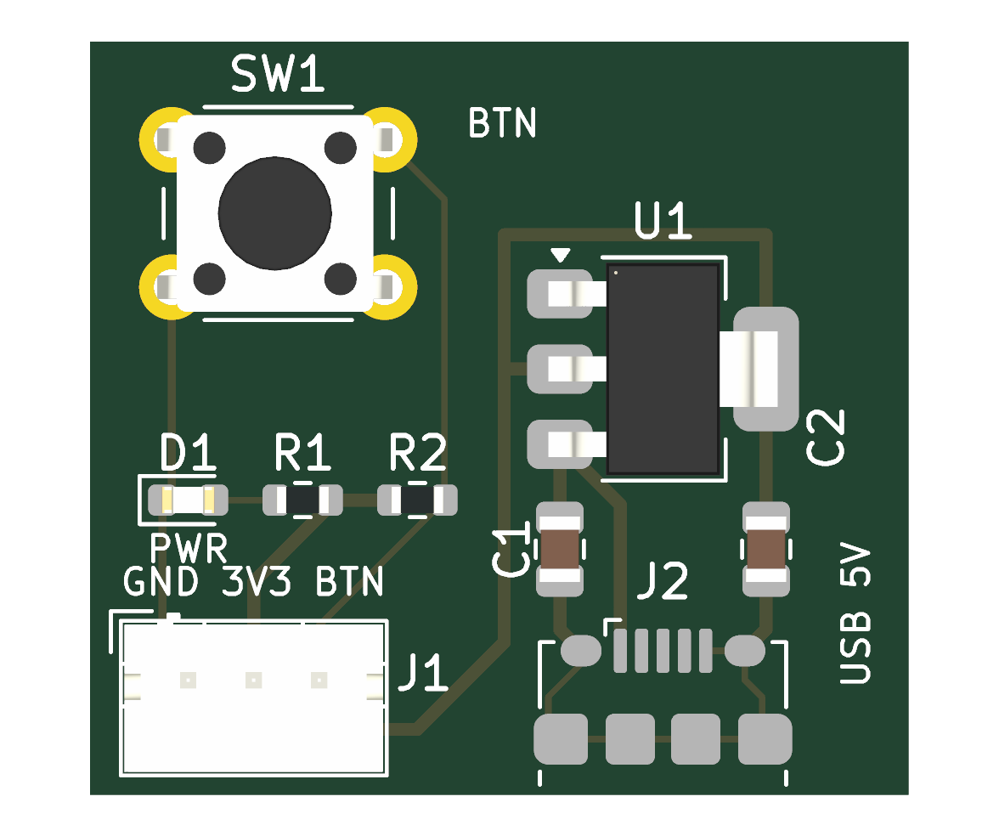
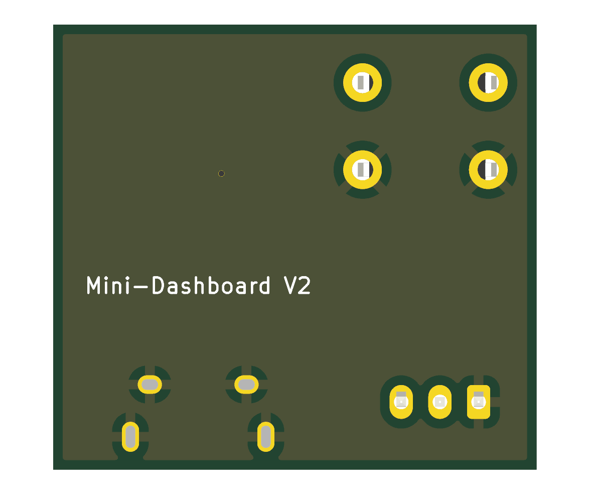

# P01 · Mini-Dashboard V2: its own power supply

V1 needed 3.3 V from another board. **V2 makes its own 3.3 V from USB**: a micro-USB socket brings 5 V, an NCP1117 linear regulator turns it into 3.3 V, and the LED and button from V1 stay. Plug it into any USB charger and the LED shows that the regulator works.

| Top | Bottom |
|---|---|
|  |  |

| | |
|---|---|
| Board | 25 × 23 mm, 2 copper layers, parts on top |
| Parts | 9 (regulator, 2 capacitors, LED, 2 resistors, button, 2 connectors) |
| Checks | see [docs/checks.md](docs/checks.md): ERC 0 / 0, DRC 0 / 0 with schematic parity |
| Files | [schematic PDF](docs/schematic.pdf) · [BOM](docs/bom.csv) · [KiCad project](kicad/) |
| Status | designed, **not manufactured, not tested** |

## Interfaces

| Connector | Pin | Signal | Note |
|---|---|---|---|
| J2 micro-USB (Amphenol 10118194-0001LF) | VBUS | 5 V in | power only |
| | D+, D−, ID | — | not connected (no USB data on this board) |
| | GND, shield | GND | |
| J1 JST PH, 2.0 mm | 1 | GND | |
| | 2 | **+3.3 V out**, max 100 mA | the other board must not have its own 3.3 V regulator on this pin |
| | 3 | BTN | 3.3 V released, 0 V pressed |

## Design decisions

| Decision | Why |
|---|---|
| **NCP1117 3.3 V linear regulator** | simple, needs only two capacitors. Its dropout is at most 1.10 V at 100 mA, so it needs ≥ 4.4 V in; USB gives 5 V |
| **10 µF 16 V X5R (0805) on the input and output** | the datasheet uses 10 µF in and out; the output capacitor is part of the regulator's control loop and keeps it stable. 16 V is more than 3× the 5 V it sees |
| **Heat check** | the board draws about 5 mA: (5.0 − 3.3) V × 5 mA = 9 mW → +1.4 °C at 160 °C/W. With the full 100 mA on J1 pin 2: 0.17 W → +27 °C, still fine |
| **No PWR_FLAG** | KiCad's micro-USB symbol marks VBUS and GND as *power output* pins, and the regulator output is one too, so ERC already sees a source on every power net |
| **USB data pins marked "no connect"** | power only for now; USB data comes with the microcontroller in V3 |
| **Footprint 10118194 instead of 10103594** | its pads (1–5 + shield) match the symbol one-to-one; the other footprint has extra pads that would have no net |
| **C1 right at the regulator's input pin, C2 right at its output tab** | a regulator's capacitors only work when they are close to its pins |
| **Power traces 0.4 mm, signals 0.25 mm** | the currents are tiny here, but it's the habit needed for boards with motors |
| **GND of the regulator through a via into the bottom GND zone** | short ground path |

## Known issues

- The USB socket's front is about 0.3 mm inside the board edge; it should sit exactly on the edge.
- No mounting holes.
- Some values are still the symbols' placeholders (`LED`, `USB_B_Micro`, `Conn_01x03_Pin`); the schematic has no revision/date yet and no note about J1 pin 2.
- The LED shows that 3.3 V exists, not that USB is plugged in; a second LED on VBUS would tell a dead regulator from a dead cable.

## Test plan (when the board is built)

| Test | Expected | Based on |
|---|---|---|
| VBUS at C1 | 4.75–5.25 V from a USB charger | USB supply |
| +3.3 V at C2 | 3.267–3.333 V (NCP1117, 25 °C) | NCP1117 datasheet |
| Voltage across R1 | about 1.3 V → LED current 4.8 mA | Ohm's law |
| J1 pin 3 | 3.3 V released, 0 V pressed | pull-up R2 |
| U1 temperature after 10 min, LED on | barely above room temperature | heat check above |
